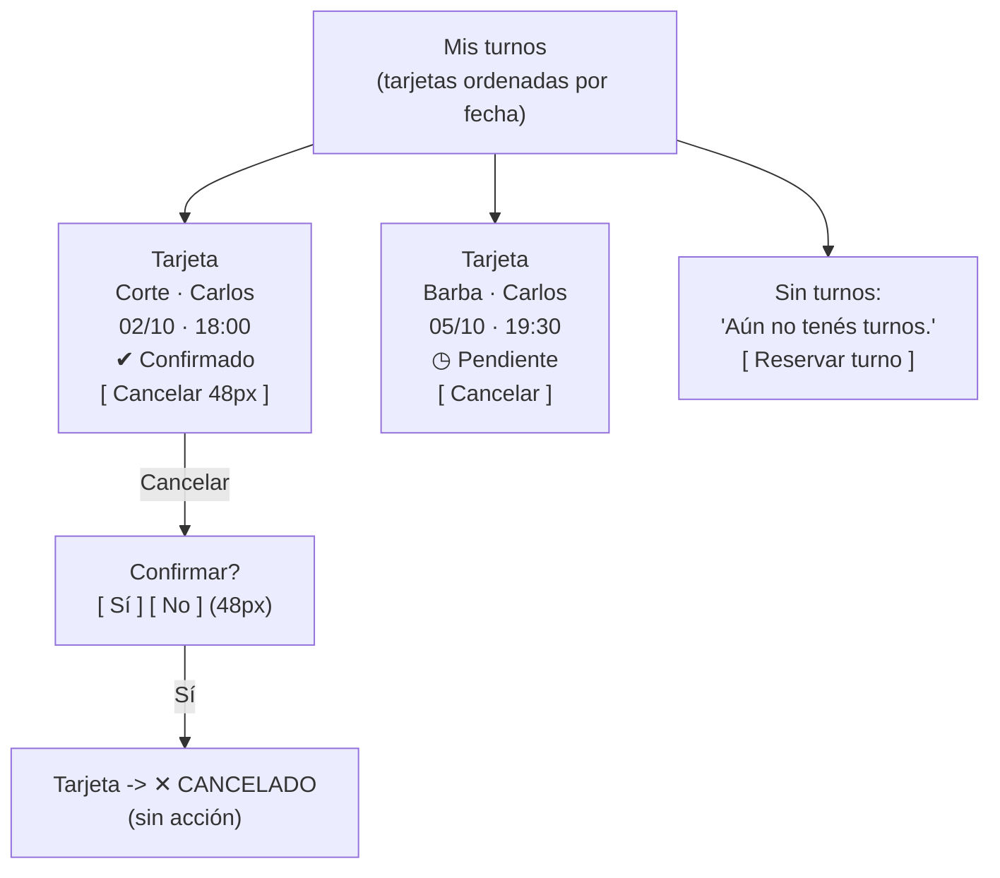

# Wireframe Adaptativo — Mis turnos (móvil < 400 px)

**Pantalla crítica 2/2 · reinterpretación móvil del wireframe del TP3** (`docs/diseno/wireframes/mis-turnos.md`).
Basado en ADR-006 (responsive web). Breakpoint de referencia: **360 × 800 px**.

- **Objetivo móvil:** leer los turnos de un vistazo y cancelar sin errores, con una mano.
- **Targets táctiles:** acción "Cancelar" con alto **≥ 48 px** y separada del borde para evitar toques accidentales.
- **Estados:** etiqueta legible + **marca visual no dependiente del color** (ícono), coherente con CA-03/CA-08.

## Comparación lado a lado

```
            DESKTOP (≥ 768 px)                          MÓVIL (< 400 px)
 ┌───────────────────────────────────────────┐   ┌───────────────────────┐
 │ MIS TURNOS                                │   │ MIS TURNOS            │
 │ ┌───────────────────────────────────────┐ │   │ ┌───────────────────┐ │
 │ │ Corte · Carlos                        │ │   │ │ Corte · Carlos    │ │
 │ │ 02/10 18:00   CONFIRMADO   [Cancelar] │ │   │ │ 02/10 · 18:00     │ │
 │ └───────────────────────────────────────┘ │   │ │ ✔ Confirmado      │ │  ← estado en
 │ ┌───────────────────────────────────────┐ │   │ │ [    Cancelar   ] │ │    línea propia
 │ │ Barba · Carlos                        │ │   │ └───────────────────┘ │  ← botón 48px
 │ │ 05/10 19:30   PENDIENTE    [Cancelar] │ │   │ ┌───────────────────┐ │
 │ └───────────────────────────────────────┘ │   │ │ Barba · Carlos    │ │
 │                                           │   │ │ 05/10 · 19:30     │ │
 │                                           │   │ │ ◷ Pendiente       │ │
 │                                           │   │ │ [    Cancelar   ] │ │
 │                                           │   │ └───────────────────┘ │
 └───────────────────────────────────────────┘   └───────────────────────┘
      fila horizontal: datos + estado + acción        tarjeta apilada
```

## Flujo (mismo comportamiento, layout adaptado)



## Qué cambió respecto a desktop y por qué

| Cambio | Antes (desktop) | Ahora (móvil < 400 px) | Motivo |
|---|---|---|---|
| Estructura de cada turno | **fila horizontal** (servicio · fecha · estado · acción) | **tarjeta apilada** (título, fecha, estado, botón) | En 360 px la fila obligaría a scroll horizontal (CA-07) |
| Estado | inline a la derecha | **línea propia**, etiqueta + ícono | Legible sin depender del color y sin truncar (CA-08) |
| Acción "Cancelar" | botón chico a la derecha | **botón full-width, 48 px**, con margen | Zona táctil segura; evita toques accidentales |
| Fecha | `YYYY-MM-DD 18:00` | `DD/MM · HH:mm` | Formato corto, sin wrap |
| Diálogo de confirmación | `window.confirm` | se mantiene, botones ≥ 48 px | Consistencia; sin pickers pesados |
| Jerarquía | densidad horizontal | una idea por tarjeta | Lectura de arriba abajo (journey-2) |
| Contenido recortado | servicio + profesional + detalle | **solo** servicio · profesional · fecha/hora · estado · acción | Menos ruido; nada esencial se corta |

## Notas de accesibilidad (CA-08 / RF-11)

- Cada estado tiene **texto** ("Confirmado", "Pendiente"…) **+ ícono** distinto (✔, ◷, ✕, ●): el significado no depende del color.
- La lista usa marcado semántico (`<ol>/<li>`) para lectores de pantalla.
- Botón "Cancelar" con foco visible y tamaño táctil ≥ 48 px.
- Tras cancelar, el estado pasa a "Cancelado" y la acción desaparece (estado terminal).
