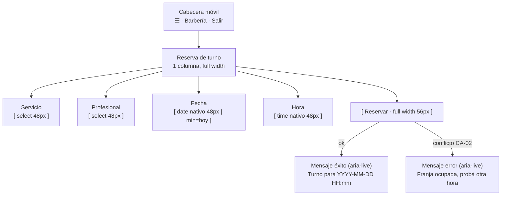

# Wireframe Adaptativo — Reserva de turno (móvil < 400 px)

**Pantalla crítica 1/2 · reinterpretación móvil del wireframe del TP3** (`docs/diseno/wireframes/reserva-turno.md`).
Basado en ADR-006 (responsive web). Breakpoint de referencia: **360 × 800 px**.

- **Objetivo móvil:** completar la reserva en ≤3 pasos con el pulgar, sin zoom ni scroll horizontal.
- **Targets táctiles:** todos los controles (selects, inputs, botón) con alto **≥ 48 px**.
- **Controles nativos:** `input type=date` y `type=time` del navegador, para evitar pickers propios pesados (coherente con RNF-03).

## Comparación lado a lado

```
            DESKTOP (≥ 768 px)                         MÓVIL (< 400 px)
 ┌───────────────────────────────────┐      ┌───────────────────────┐
 │ CABECERA: Barbería   usuario Salir│      │ ☰  Barbería    Salir  │
 ├───────────────────────────────────┤      ├───────────────────────┤
 │        RESERVA DE TURNO           │      │   RESERVA DE TURNO    │
 │                                   │      │                       │
 │ Servicio      Profesional         │      │ Servicio              │
 │ [ Corte  ▼ ]  [ Carlos    ▼ ]     │      │ [ Corte 30min  ▼ ]    │  ← full width
 │                                   │      │                       │
 │ Fecha               Hora          │      │ Profesional           │
 │ [ 2026-11-05 ]      [ 18:00 ]     │      │ [ Carlos       ▼ ]    │  ← apila 2→1 col
 │                                   │      │                       │
 │                [ Reservar ]       │      │ Fecha                 │
 │                                   │      │ [ 2026-11-05 📅 ]     │  ← nativo, 48px
 │                                   │      │                       │
 │                                   │      │ Hora                  │
 │                                   │      │ [ 18:00 🕐 ]          │
 │                                   │      │                       │
 │                                   │      │ [    RESERVAR    ]    │  ← full width, 56px
 └───────────────────────────────────┘      └───────────────────────┘
        servicio/profesional en 2 col            todo en 1 columna
```

## Flujo (mismo comportamiento, layout adaptado)



## Qué cambió respecto a desktop y por qué

| Cambio | Antes (desktop) | Ahora (móvil < 400 px) | Motivo |
|---|---|---|---|
| Disposición de campos | 2 columnas (servicio/profesional, fecha/hora) | **1 columna**, ancho completo | Evita scroll horizontal (CA-07) y targets chicos |
| Altura de controles | ~36 px | **≥ 48 px** | Área táctil recomendada (Material/web.dev); Apple HIG usa 44 pt |
| Botón principal | alineado a la derecha, tamaño texto | **full-width, 56 px**, texto centrado | Acción principal alcanzable con el pulgar |
| Selectores de fecha/hora | inputs de texto/compactos | **nativos** `date`/`time`, 48 px | Menos errores de tipeo y menor peso JS |
| Cabecera | horizontal amplia | compacta (menú ☰ + Salir) | Ahorra ancho; acciones primarias a la vista |
| Jerarquía | título + formulario | título, luego campos en orden de journey-1 | Lectura de arriba abajo, un solo foco por paso |
| Contenido recortado | etiqueta + hint largos | **etiqueta corta + hint de una línea** (p. ej. "Corte · 30min · $15" en el select) | Evita wraps y ruido en 360 px |

## Notas de accesibilidad (CA-08 / RF-11)

- Foco visible en todos los controles, incluido el botón full-width.
- Errores y confirmación anunciados con `aria-live="polite"`.
- Contraste AA (4.5:1 texto, 3:1 bordes/foco); el estado nunca depende solo del color.
- Orden de tabulación = orden visual (servicio → profesional → fecha → hora → reservar).
