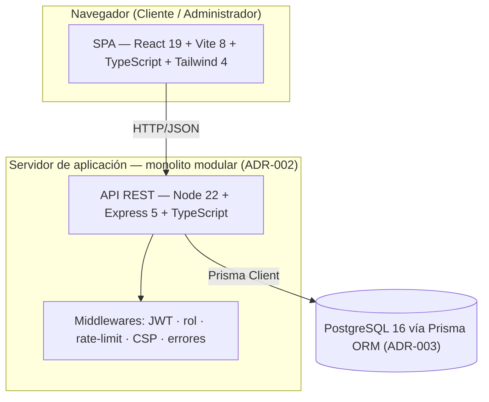

# Informe Final — PP3 · Sistema de Turnos

**Práctica Profesionalizante III · IES 9-018 · Ciclo 2026**
**Proyecto:** Sistema de Turnos para peluquería/barbería
**Repositorio:** [IES9018/Ezequiel-Sistema-Turnos](https://github.com/IES9018/Ezequiel-Sistema-Turnos)
**Release:** [`v0.1.0`](https://github.com/IES9018/Ezequiel-Sistema-Turnos/releases/tag/v0.1.0) · **Entrega:** 2026-11-17 · **Defensa integradora ADI:** 2026-11-19
**Entregable:** DEL-CIE-03 (informe final + demo)

---

## 1. Resumen ejecutivo

El proyecto digitaliza la gestión de turnos de una peluquería/barbería: reserva online para clientes, agenda diaria para el administrador y API REST segura sobre PostgreSQL. Se construyó en cuatro etapas (Sprint 1, 2, 3 y Cierre) con un flujo de trabajo dirigido por especificación, decisiones arquitectónicas registradas (ADR) y un arnés de IA que evolucionó hasta consolidarse.

**El sistema está desplegado de forma reproducible, protegido, medido y versionado:** CI en verde que protege `main`, release `v0.1.0` etiquetada, 50 tests verdes, presupuestos de rendimiento dentro de objetivo y las 8 amenazas STRIDE del threat model mitigadas en código.

| Indicador | Valor |
|---|---|
| Commits | 49 |
| Pull Requests mergeados | 18 (del #3 al #21; todos con CI y checklist) |
| ADRs | 6 (ADR-001…ADR-006) |
| Tests | **50** (36 server + 14 client) · 0 fallos |
| Cobertura (módulos puros del server) | 98.33 % statements · 89.18 % branches · 100 % funciones |
| JS inicial | **61.1 KB gzip** (presupuesto < 200 KB) |
| LCP móvil (mediana de 3) | login **1.72 s** · reserva **1.91 s** · agenda admin **1.61 s** (RNF-01 < 2.5 s) |
| INP (click primario) | **160 ms** reserva · **32 ms** agenda (RNF-02 < 200 ms) |
| Amenazas STRIDE mitigadas | **8/8** (T-01…T-08) |
| Contrato OpenAPI | 6 operaciones críticas (5 paths), lint sin errores |

---

## 2. Alcance entregado y estado frente a la SPEC

### 2.1 Requerimientos funcionales

| RF | Descripción | Estado | Dónde |
|---|---|---|---|
| RF-01 | Alta/baja/modificación de servicios | **API completa** (UI admin pendiente) | `server/routes/servicios.ts` |
| RF-02 | Alta/baja/modificación de profesionales | **API completa** (UI admin pendiente) | `server/routes/profesionales.ts` |
| RF-03 | Disponibilidad por día y profesional | **Implementado** | `GET /profesionales/:id/disponibilidad` + `ReservaForm` |
| RF-04 | Reserva de turno (servicio + profesional + fecha/hora) | **Implementado** | `POST /turnos` + `ReservaForm` |
| RF-05 | Confirmación por email/notificación | **Fuera de alcance** (no implementado) | — |
| RF-06 | Listado de turnos del día para el administrador | **Implementado** (CA-03) | `AdminAgenda.tsx` |
| RF-07 | Cancelación por el cliente | **Implementado** (sin anticipación mínima configurable) | `PATCH /turnos/:id/estado` + `TurnosList` |
| RF-08 | Dashboard de métricas | **Fuera de alcance** | — |
| RF-09 | Registro/login con roles diferenciados | **Implementado** | `server/routes/auth.ts` + `AuthForm` |
| RF-10 | Horarios especiales (feriados) | **Fuera de alcance** | — |
| RF-11 | Accesibilidad WCAG AA en pantallas críticas | **Parcial** (etiquetas, foco, contraste y estado no dependiente del color; sin auditoría WCAG formal) | `docs/diseno/auditoria-heuristica.md` |

Los RF no implementados no son deuda oculta: están fuera del alcance priorizado del cuatrimestre y se listan en la sección 10 (trabajo futuro).

### 2.2 Non-Goals declarados

NG-01 pagos online · NG-02 app nativa · NG-03 integración con Google Calendar · NG-04 reseñas · NG-05 multi-sucursal · **NG-06 sincronización offline** (justificado en `docs/arquitectura/offline-sync.md` con condición de reapertura).

---

## 3. Arquitectura

### 3.1 Estilo y stack

**Monolito modular** (ADR-002): un único proceso Express sirve la API REST y la SPA compilada; PostgreSQL se accede exclusivamente vía Prisma (ADR-003). La API es REST sin estado (ADR-001) y el frontend es React + Vite + Tailwind (ADR-004).



Diagramas completos: `docs/arquitectura/C4-contexto.md` y `docs/arquitectura/C4-contenedores.md`.

### 3.2 Decisiones registradas

| ADR | Decisión | Restricción trazada |
|---|---|---|
| ADR-001 | Stack tecnológico (React + Express + PostgreSQL + JWT) | R-03, R-04 |
| ADR-002 | Monolito modular | R-01 |
| ADR-003 | Persistencia PostgreSQL vía Prisma | R-02 |
| ADR-004 | Stack de UI (React + Tailwind, componentes funcionales) | R-04 |
| ADR-005 | Estrategia web (SPA + API REST) | R-03 |
| ADR-006 | Estrategia mobile: **responsive web** (no nativa/PWA) | R-06 · NG-02 · NG-06 |

### 3.3 Contrato API-First

`docs/arquitectura/api-contracts.yaml` (OpenAPI **v1.1.0**) documenta las **6 operaciones críticas** del alcance: `POST /auth/login`, `GET /servicios`, `GET /profesionales/{id}/disponibilidad`, `GET /turnos`, `POST /turnos` y `PATCH /turnos/{id}/estado`. El contrato se lintea con Redocly en cada PR (0 errores/warnings) y se escribió **antes** de implementar/endurecer esas operaciones. Detalles clave:

- `GET /turnos?fecha=YYYY-MM-DD` con alcance por rol (ADMIN ve todo; CLIENTE solo lo propio).
- `TurnoRequest` **no** acepta `clienteId`: la identidad sale del JWT (mitiga IDOR/BOLA).
- `403` en rutas admin o recursos ajenos; `429` en login y creación de turnos.

---

## 4. Seguridad

Modelo STRIDE lite con **8 amenazas** sobre 5 endpoints, todas con mitigación aplicada y verificable (`docs/seguridad/threat-model-lite.md`):

| ID | Amenaza | Mitigación aplicada |
|---|---|---|
| T-01 | Fuerza bruta en login | bcrypt + rate-limit 5/min + mensaje uniforme |
| T-02 | IDOR al reservar por otro | identidad desde el JWT (`req.userId`) |
| T-03 | Manipular servicio/profesional/horario | backend recalcula `horaFin` y valida superposición |
| T-04 | Repudio de cambios de estado | `AuditLog` (usuario, turno, estado anterior→nuevo) |
| T-05 | Fuga de hash de contraseña | `select` explícito de Prisma; nunca se serializa `password` |
| T-06 | DoS por volumen de requests | rate-limit por IP + `express.json({ limit: "100kb" })` |
| T-07 | Escalamiento de privilegios | `authRequired` + `requireRole("ADMIN")` en middleware |
| T-08 | Robo de JWT por XSS | React escapa por defecto + **CSP estricta** en `security-headers.ts` |

Además: `X-Content-Type-Options`, `X-Frame-Options: DENY`, `Referrer-Policy: no-referrer`, `Permissions-Policy`, `x-powered-by` deshabilitado y secretos solo por entorno (`JWT_SECRET` sin fallback).

---

## 5. Testing y calidad

| Suite | Archivos | Tests | Estado |
|---|---|---|---|
| Server (reglas puras + utils + middleware) | 6 | **36** | ✅ |
| Client (servicio API + componentes RTL) | 2 | **14** | ✅ |
| **Total** | 8 | **50** | **0 fallos** |

- **Cobertura** (v8, módulos puros del server): 98.33 % statements, 89.18 % branches, 100 % funciones, 98.21 % líneas. Reporte histórico: `docs/pruebas/reporte-sprint2.md`.
- **Determinismo:** las reglas de negocio se extrajeron a módulos sin I/O (`server/utils/`) justamente para testearlas sin base de datos. Se cubren casos borde: cruce de medianoche, franjas contiguas y superposición.
- **Accesibilidad:** tests de etiquetas legibles, orden por hora y estados vacío/error de la agenda; revisión heurística en `docs/diseno/auditoria-heuristica.md`.

### Pipeline CI (DEL-CIE-01)

`.github/workflows/ci.yml` se ejecuta en cada PR a `main`; el merge se hace **solo con CI verde** (política del proyecto reflejada en la plantilla de PR):

1. `npm ci` (server) y `npm ci` (client) — instalación reproducible.
2. **Lint del contrato OpenAPI** (`@redocly/cli`).
3. Typecheck/build del server (`tsc` estricto).
4. Tests del server (36).
5. Build del client.
6. **Presupuesto de peso JS** (`npm run budget`, falla > 200 KB gzip).
7. Lint del client (`oxlint`).
8. Tests del client (14).
9. **Lighthouse CI** (`@lhci/cli`): LCP ≤ 2.5 s, CLS ≤ 0.1 y accesibilidad ≥ 0.9.

Badge en el README: 

---

## 6. Rendimiento medido (RNF)

Perfil: mobile, 360×800, throttling simulado de Lighthouse 12. Las pantallas autenticadas se miden inyectando la sesión con Puppeteer y navegando directo a `/` (sin página-puente). Evidencia cruda y método: `docs/deploy/evidencia/`.

| Métrica | Pantalla | Valor | Presupuesto | Estado |
|---|---|---|---|---|
| LCP | Login | **1.72 s** | < 2.5 s | ✅ |
| LCP | Reserva | **1.91 s** (máx 2.46 s) | < 2.5 s | ✅ |
| LCP | Agenda admin | **1.61 s** (máx 1.75 s) | < 2.5 s | ✅ |
| INP | Reserva | **160 ms** | < 200 ms | ✅ |
| INP | Agenda admin | **32 ms** | < 200 ms | ✅ |
| JS inicial | Ambas | **61.1 KB gzip** | < 200 KB | ✅ |
| Scroll horizontal | Ambas @360 px | **0 px** | 0 px | ✅ |

**Corrección metodológica documentada:** una medición anterior usaba un puente con redirección que inflaba el LCP de la agenda a 2.59 s. Re-medida sin puente, el valor real es 1.61 s. El *code-splitting* con `React.lazy` se probó y descartó: no mejoraba el LCP y subía el JS a 63.5 KB gzip (React DOM domina el bundle). Ver `docs/arquitectura/presupuestos-rendimiento.md` y `docs/auditoria/auditoria-sprint3.md` §7.

---

## 7. Despliegue y operación (DEL-S3-04)

**Artefacto reproducible:** `Dockerfile` multi-stage (build server+client → runtime `node:22-alpine`) + `docker-compose.yml` (app + PostgreSQL 16, healthcheck, DB en host 5433). Guía completa: `docs/deploy/deploy.md`.

- **Variables:** `DATABASE_URL` (sí), `JWT_SECRET` (sí, sin fallback), `PORT` (no), `NODE_ENV=production`.
- **Servido en producción:** un solo proceso sirve `/api/*` y la SPA con *fallback* a `index.html`; gzip y caché inmutable para assets con hash.
- **Seed idempotente:** `npm run db:seed` crea usuarios demo, servicios y disponibilidad.
- **Verificación local ejecutada:** salud, login, CSP y cabeceras, y `Content-Encoding: gzip` (ver `docs/deploy/deploy.md`).
- **Limitación declarada:** el entorno de desarrollo no tiene Docker, por lo que se verificó el camino local equivalente y se entrega el artefacto Docker sin ejecución end-to-end.

---

## 8. Gestión del proyecto

- **21 PRs** mergeados (#3 a #21), cada uno con la plantilla oficial, checklists de calidad/seguridad y **CI en verde**. Sin push directo a `main` una vez adoptado el flujo.
- **Flujo usado:** `feature/<tema>` o `bugfix/<tema>` → PR a `main` → CI verde → self-merge con checklists (modelo de repo individual de `sprint-pp3-config.json`).
- **Documentación viva:** SPEC con changelog v1→vFinal, 6 ADRs, contrato OpenAPI, threat model, C4, wireframes, presupuestos, guía de despliegue.
- **Auditoría crítica de IA por sprint** (`docs/auditoria/`) y **postmortem del cuatrimestre** (`docs/postmortem-cuatrimestre.md`) con 6 incidentes reales, evidencia enlazada y la capa que los previene.
- **Arnés consolidado** (`.opencoderules` vFinal) en cuatro secciones: Alcance / Estándares / Prohibiciones / Proceso. El pipeline es ahora quien hace cumplir las reglas que antes se verificaban a mano.

### Hitos por etapa

| Etapa | Entregables clave |
|---|---|
| Sprint 1 | Repo, SPEC v1, ADR-001, arnés, plantilla PR, CI básico, auditoría S1 |
| Sprint 2 | Núcleo funcional, ADR-002/003/004, C4, suite + reporte, auditoría S2 |
| Sprint 3 | Seguridad aplicada, agenda admin, ADR-006/presupuestos, despliegue, auditoría S3 |
| Cierre | Pipeline CI completo, release `v0.1.0`, arnés vFinal, postmortem, este informe |

---

## 9. Release `v0.1.0` y demo

### 9.1 Release

- **CHANGELOG.md** en formato Keep a Changelog con sección `[0.1.0] - 2026-11-03` (Added / Changed / Fixed / Security / Documentation).
- **Tag anotado `v0.1.0`** sobre el commit de merge del cierre (PR #20) y **GitHub Release** publicada.
- **SPEC vFinal** congelada para la defensa, con R-06 y trazabilidad SPEC ↔ ADR ↔ restricciones.

### 9.2 Guion de demo (5–8 minutos)

**Preparación (una vez):**

```bash
npm ci && npm --prefix client ci
npx prisma generate && npx prisma db push && npm run db:seed
npm run build && npm --prefix client run build
NODE_ENV=production PORT=3001 node dist/index.js
# Abrir http://localhost:3001
```

1. **Login administrador** — `admin@turnos.test` / `admin1234` → se abre la **agenda del día**, ordenada por hora, con etiqueta e ícono por estado (CA-03). Cambiar la fecha y mostrar el estado vacío.
2. **Login cliente** — cerrar sesión, entrar con `cliente@turnos.test` / `cliente1234` → elegir servicio, profesional y fecha; seleccionar una franja disponible y **reservar**. El turno aparece en “Mis turnos”.
3. **Agenda admin** — volver a entrar como admin y mostrar el turno recién creado en la fecha correspondiente.
4. **Cancelación** — como cliente, cancelar el turno desde “Mis turnos” y verificar el cambio de estado.
5. **Seguridad (opcional)** — con el token del cliente, `PUT /api/servicios/:id` devuelve **403**; repetir login fallido devuelve **429** por rate-limit; el cambio de estado deja fila en `AuditLog`.
6. **Calidad y entrega** — mostrar en GitHub: PR #20 con **CI verde**, release `v0.1.0`, badge de CI y la evidencia de Lighthouse en `docs/deploy/evidencia/`.

---

## 10. Limitaciones y trabajo futuro

1. **Funcionalidad pendiente:** UI de administración de servicios/profesionales (la API ya existe), anticipación mínima configurable para cancelar (RF-07), notificaciones por email (RF-05), dashboard de métricas (RF-08) y horarios especiales (RF-10).
2. **Despliegue productivo:** migraciones versionadas (`prisma migrate deploy`) en lugar de `db push`, HTTPS/HSTS en un reverse proxy, PostgreSQL gestionado, publicación de imagen en un registry y observabilidad (logs estructurados + health de DB).
3. **Testing:** incorporar E2E del flujo reserva→cancelación (el apéndice avanzado de testing de consistencia queda como próximo paso) y medir INP en CI (hoy se mide por CDP en local).
4. **Performance:** mantener los presupuestos como *assertions* bloqueantes y vigilar el crecimiento del bundle antes de sumar features.
5. **Contrato:** el CRUD administrativo de servicios/profesionales y `POST /auth/register` están implementados y protegidos, pero no figuran en el contrato v1.1.0 (que cubre el camino crítico). Ampliar el contrato para cubrir el 100 % de las rutas es deuda de documentación previa a la defensa.

---

## 11. Trazabilidad de entregables PP3

| ID | Entregable | Evidencia en el repo |
|---|---|---|
| DEL-S1-01 | Estructura base del repositorio | repo + `.opencoderules` |
| DEL-S1-02 | Plantilla de Pull Request | `.github/PULL_REQUEST_TEMPLATE.md` |
| DEL-S1-03 | Auditoría crítica S1 | `docs/auditoria/auditoria-sprint1.md` |
| DEL-S2-01 | Núcleo funcional | `server/` + `client/src/` |
| DEL-S2-02 | Diagramas C4 | `docs/arquitectura/C4-contexto.md`, `C4-contenedores.md` |
| DEL-S2-03 | Suite de pruebas + reporte | `tests/`, `client/tests/`, `docs/pruebas/reporte-sprint2.md` |
| DEL-S2-04 | Auditoría crítica S2 | `docs/auditoria/auditoria-sprint2.md` |
| DEL-S3-01 | API según contrato OpenAPI | `docs/arquitectura/api-contracts.yaml` (lint OK) |
| DEL-S3-02 | Threat model aplicado | `docs/seguridad/threat-model-lite.md` (T-01…T-08) |
| DEL-S3-03 | Presupuestos medidos | `docs/arquitectura/presupuestos-rendimiento.md` + `docs/deploy/evidencia/` |
| DEL-S3-04 | Despliegue funcional / artefacto | `docs/deploy/deploy.md`, `Dockerfile`, `docker-compose.yml` |
| DEL-S3-05 | Auditoría crítica S3 | `docs/auditoria/auditoria-sprint3.md` |
| **DEL-CIE-01** | **Pipeline CI en verde** | `.github/workflows/ci.yml` + badge |
| **DEL-CIE-02** | **Release v0.1.0 con CHANGELOG** | `CHANGELOG.md` + tag `v0.1.0` |
| **DEL-CIE-03** | **Informe final + demo** | este documento + sección 9.2 |

---

## 12. Conclusión

El proyecto pasó de un núcleo funcional local a un sistema **seguro, medido, versionado y reproducible**, con un proceso que no depende de la memoria: la SPEC fija el alcance, los ADR justifican las decisiones, el contrato ordena la API, los tests y los presupuestos verifican, y el pipeline bloquea lo que no cumple. La IA aceleró la implementación, pero cada incidente quedó auditado y convertido en una regla del arnés o en un check del CI.

La deuda restante está declarada y priorizada. La release `v0.1.0` es una base defendible para continuar: agregar la UI administrativa, notificaciones y E2E, y endurecer el despliegue productivo sin renegociar los presupuestos ya medidos.

---

## 13. Evidencia

- Repositorio: https://github.com/IES9018/Ezequiel-Sistema-Turnos
- Release: https://github.com/IES9018/Ezequiel-Sistema-Turnos/releases/tag/v0.1.0
- CI: https://github.com/IES9018/Ezequiel-Sistema-Turnos/actions
- PRs: [#3](https://github.com/IES9018/Ezequiel-Sistema-Turnos/pull/3) a [#21](https://github.com/IES9018/Ezequiel-Sistema-Turnos/pull/21)
- Documentación: `SPEC.md`, `docs/adr/`, `docs/arquitectura/`, `docs/seguridad/`, `docs/pruebas/`, `docs/deploy/`, `docs/auditoria/`, `docs/postmortem-cuatrimestre.md`
